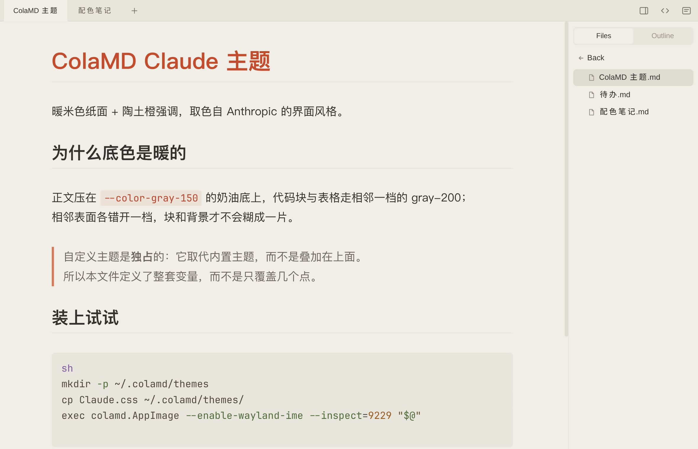

# colamd-tweaks

给 [ColaMD](https://colamd.app)（Electron + CodeMirror 的 Markdown 阅读/编辑器）的本机定制合集：一套 Claude 风格的主题 + 一组启动器/注入脚本。

- **主题**（`Claude.css`）——谁都能用，拷进 `~/.colamd/themes/` 即可。
- **launcher / 注入**（`launcher/`）——**只对本机有意义**：路径写死成 `$HOME/.local/bin/…`、依赖本机装的字体文件。clone 的人忽略这个目录就好。


## 本机对 ColaMD 做了什么

App 的代码在只读打包里（AppImage，或发行版包里的 `app.asar`），改不动，所以除了主题（数据）之外的一切都靠"启动时从外部注入"实现。

| # | 定制 | 效果 | 落点 |
|---|---|---|---|
| 1 | 主题 `Claude.css` | 暖米纸面 + 陶土橙；顶栏/标签栏配色；h1 固定红；代码块等宽字体；语法高亮换暖色板；单标签时收起整条标签栏 | `~/.colamd/themes/Claude.css` |
| 2 | 启动器 `launcher/colamd` | 加 `--enable-wayland-ime`；开渲染层 CDP（9222）与主进程 inspector（9229）；挂上窗口装饰补丁；启动后在后台跑两个注入 | `~/.local/bin/colamd`（符号链接） |
| 3 | 窗口装饰补丁 `launcher/colamd-frame-patch.cjs` | 去掉 Wayland 上那条 37px 的原生标题栏（`ColaMD ✕`）；顺带原生菜单栏不再占行，菜单入口改由顶栏汉堡按钮承担 | 同上（经 `NODE_OPTIONS` 预加载） |
| 4 | 渲染层注入 `launcher/colamd-render-inject.mjs` | 代码块里按 Tab 插真缩进；上游装饰排序 bug 的临时补丁；`+` 右侧加「打开文件」按钮；显出 App 自带的汉堡菜单按钮 | 同上 |
| 5 | 主进程注入 `launcher/colamd-main-inject.mjs` | 原生菜单栏启动默认隐藏（`Alt` 仍能唤出） | 同上 |
| 6 | 查询工具 `launcher/colamd-{cdp,main,fonts}.mjs` | 在渲染层/主进程里执行任意 JS 表达式；查节点真正加载的字体文件 | 同上 |

AppImage 本体不在本仓库（`~/.local/bin/colamd.AppImage`，由 App 自带 updater 维护）。

## 目录

```
Claude.css                     主题本体（纯 CSS）
launcher/                      本机自用
├── colamd                     启动器 wrapper（desktop 的 Exec 指向它）
├── colamd-frame-patch.cjs     窗口装饰补丁：去掉 Wayland 上的原生标题栏
├── colamd-render-inject.mjs   渲染层注入：Tab 缩进 / 装饰补丁 / 顶栏两个按钮
├── colamd-main-inject.mjs     主进程注入：隐藏原生菜单栏
├── colamd-cdp.mjs             渲染层执行 JS
├── colamd-main.mjs            主进程执行 JS
└── colamd-fonts.mjs           查真正加载的字体
assets/                        预览图与截图
```

## 安装

### 主题（任何 ColaMD）

```sh
mkdir -p ~/.colamd/themes
cp Claude.css ~/.colamd/themes/
```

然后**重启 ColaMD**——Theme 菜单里的自定义主题项是在 App 启动时扫描 `~/.colamd/themes/` 生成的，新文件不重启不会出现。重启后在 Theme 菜单里选 `Claude`。**菜单项显示的就是文件名（去掉 `.css`）**，大小写原样保留，所以想要显示成 `Claude` 就得把文件命名成 `Claude.css`。

改完文件内容不必重启：重新点一次 Theme 菜单里的 `Claude` 即可（点击时才读文件）。

命名相关的坑：ColaMD 用**文件名**做主题标识（`localStorage["colamd-theme"] = "custom:Claude.css"`），所以**重命名文件等于换了一个主题**——旧的选择记录会失效，启动时找不到对应文件，页面会退回无主题样式，重新在菜单里选一次即可。

### launcher / 注入（本机）

`~/.local/bin/` 里只放符号链接，脚本本体在本仓库：

```sh
for f in colamd colamd-frame-patch.cjs colamd-render-inject.mjs colamd-main-inject.mjs colamd-cdp.mjs colamd-main.mjs colamd-fonts.mjs; do
  ln -sf "$HOME/Projects/colamd-tweaks/launcher/$f" "$HOME/.local/bin/$f"
done
```

desktop 条目的 `Exec` 指向 `~/.local/bin/colamd`。wrapper 自己挑要启动的 ColaMD：`~/.local/bin/colamd.AppImage` 存在就用它，否则用发行版包（`/usr/bin/colamd`）；`COLAMD_APP` 可覆盖。启动链：wrapper 开两个调试端口 → 后台跑 `colamd-render-inject.mjs`（连 CDP 9222）与 `colamd-main-inject.mjs`（连 inspector 9229）→ 再 `exec` App。两个注入都是独立进程，连不上就自己退出，**不影响 App 启动**；日志分别在 `/tmp/colamd-render-inject.log`、`/tmp/colamd-main-inject.log`。

注入进程与 App 同生共死：wrapper 把 App 的 PID 传给渲染层注入，App 一退它就退出。没有这条，App already running 时再点一次图标（会起第二个 wrapper）留下的注入进程会挂到在跑那个 App 的端口上、一直不退。

## 主题细节

### 外观



底色用的是 Anthropic 设计 token 里的 `--color-gray-150`（`#f0eee6`，Claude 界面的奶油底），相邻表面按同一套官方灰阶错开一档，免得代码块糊进背景里。

| 元素 | 颜色 |
|---|---|
| 背景 | `#f0eee6`（`--color-gray-150`） |
| 正文 | `#33312e` |
| 次级文字 / 弱化文字 | `#6b675e` / `#98938a` |
| 链接 | `#c15f3c` |
| 引用块左边线 | `#d97757`（Anthropic `--color-clay`） |
| 行内代码底 / 字 | `rgba(200, 120, 80, 0.1)` / `#b8452a` |
| 代码块底 / 字 | `#e8e6dc`（`--color-gray-200`）/ `#4f4a40` |
| 引用块底 | `#faf9f5`（`--color-gray-050`） |
| 表格表头 / 描边 | `#e8e6dc` / `#dedcd1` |
| 高亮 | `#f7e7d5` |
| 一级标题 | `#c44b2b`（固定，覆盖正文色） |

`theme-*` 内置主题的 h1 只是继承正文色；这里显式给它压了一行红，以匹配 Claude 的标题观感。

### 代码块语法高亮

代码 token 的颜色不写在主题的 `:root` 里，而是由 `--code-*` 变量走：ColaMD 读 `--code-block-bg` 的明暗给 `body` 挂上 `code-palette-light`（浅底）或不挂（深底），两套调色板分别定义在各自的选择器下（见 `applyCodePalette()`）。内置的浅色那套是 GitHub Light 的冷色，压在暖米纸面上出戏，所以本主题整条覆盖：

| token | 颜色 |
|---|---|
| 关键词 | `#b8452a`（与 h1 同族的陶土红） |
| 字符串 | `#6b5b32` |
| 注释 | `#8a8478` |
| 数字 | `#9c5a1e` |
| 函数 | `#7d5a9e` |
| 类型 | `#8a5a2b` |
| 属性 | `#4f6b3a` |
| meta | `#6b6072` |

运算符、标点、括号刻意不给颜色（跟随代码块正文色），整块才不会花。注意这条覆盖挂在 `body.code-palette-light` 下：一旦把 `--code-block-bg` 改成深色，ColaMD 会切去深色那套，这段就不再生效，得换个选择器重写。

### 顶栏与标签栏

顶栏这一整行在 ColaMD 内部叫 chrome，底色与描边都走 CSS 变量，所以主题也管得到——**但这几个变量必须定义在 `body` 上，不能写 `:root`**：自定义属性在「定义处」解析，App 把 chrome 变量定义在 `body`、各内置主题在 `body.theme-*` 上覆盖基础变量，而 `html` 看不到那些覆盖（App 源码原话：These MUST live on body, never on `:root`）。写在 `:root` 里是**静默失效**——同一份文件里的其他规则照旧生效，只有这几个变量停在默认值。本主题把它们写在 `body.theme-custom` 下。

| 变量 | 本主题取值 | 作用 |
|---|---|---|
| `--chrome-bg` | `#e8e6dc`（gray-200） | 顶栏底色，比纸（gray-150）深一档；**侧栏的「文件 / 大纲」轨道（`.file-panel-tabs`）也用它**，所以不能设成纸色，否则侧栏跟正文糊成一片 |
| `--chrome-bg-hover` | `#dedcd1`（gray-250） | 标签悬停底色 |
| `--shell-line` | `#dedcd1`（gray-250） | 壳里所有接缝：标签边界、顶栏基线、面板边缘 |
| `--row-icon-color` | `--text-secondary` 的 88% | 顶栏那四个图标按钮；App 默认是 `--text-muted` 的 55% 透明，压在暖灰上几乎看不见 |

外加两条规则：

- **标签文字**：未激活 `--text-secondary`、悬停与激活 `--text-color`。选择器带 `#titlebar` 前缀，压过 App 自己的类选择器，不赌注入顺序。
- **只有一个标签时整条标签栏收起**：`#tab-bar:not(:has(.tab-entry ~ .tab-entry)) { display: none !important }`。`+` 按钮与右侧图标是 `#titlebar` 的子元素、不在 `#tab-bar` 里，所以不跟着消失；开出第二个标签，这条栏自己回来。

### 版本适配：2.7 换了编辑器内核

ColaMD 2.7 起编辑器内核从 Milkdown 换成 CodeMirror，行类名的写法整个变了。本文件按 2.7+ 写；2.6 及更早的版本上，下面这几条按 `.cm-md-*` 写的规则不会命中任何元素：

| 元素 | 2.7+（CodeMirror） | 2.6−（Milkdown） |
|---|---|---|
| 一级标题 | `.cm-content .cm-md-atxheading1` | `.ProseMirror h1` |
| 代码块 | `.cm-content .cm-md-codeblock` | `.ProseMirror pre` |
| 行内代码 | `.cm-content .cm-md-inlinecode` | `.ProseMirror code` |

`:root` 里那套变量两代通用。

### 代码块字体：需要按环境改

代码块用 `Google Sans Code`，**按族名**写在 `font-family` 里，字体得你自己装（本机在 `~/.local/share/fonts/GoogleSansCode/`）。没装不会报错，只是静默回退到 `monospace`。

```css
#editor .cm-content .cm-md-codeblock,
#editor .cm-content .cm-md-codeblock *,
#editor .cm-content .cm-md-inlinecode {
  font-family: "Google Sans Code", monospace !important;
}
```

**别用 `@font-face` + `file://` 指字体文件**：那条路会让渲染器每次应用主题都解析整份字体。本主题一度把 13MB 的中文 PingFang 这样挂上，实测应用一次要 1.0–2.6s CPU，改成系统族名后降到 0.19–0.27s（同一进程内切主题，3 轮对调顺序复现）。按族名走 fontconfig 就没有这个开销。

按族名的代价：在部分 Linux 上 `fc-match` 可能把族名解析成别的字体，核对一下返回值即可。另外 `Google Sans Code` **不含汉字**，代码块里的中文由系统 fallback 链决定，要单独指定中文得另加一节 `font-family`。

### 说明

- ColaMD 的自定义主题是**独占**的：它取代内置主题而不是叠加，所以本文件定义了整套 CSS 变量，而不是只覆盖几个点。想在内置主题上叠加单条规则（比如只要那行红标题）做不到。
- 自定义主题的内容是原样注入一个 `<style>`，因此除变量外可以写任意 CSS。
- 主题切换时 body 上的 class 会被重置，要长期生效的样式请注入 `<style>` 或写进主题文件，别依赖注入的 class。
- 选中自定义主题时，body 上**只有** `theme-custom` 这一个 class（内置的 `theme-*` 全被移除）。内置主题里那些 `body.theme-x .cm-content .cm-md-*` 的写法因此不会生效——行内代码的颜色就属于这一类，需要在主题文件里自己补。

## launcher 与注入

### 渲染层注入（`colamd-render-inject.mjs`）

一个脚本管四件事，因为**一个 page target 只接受一个 debugger 客户端**，拆成多个脚本会互抢 CDP 连接。

| 注入 | 做法 |
|---|---|
| 代码块里按 Tab 插缩进 | capture 阶段拦 keydown：命中 `#editor`/`#source-editor` 且不在 `li`/`td`/`th` 里时插真 `\t`（`execCommand`），焦点不动。ColaMD 原生 Tab 会把焦点移出编辑器 |
| 上游装饰排序 bug 的补丁 | 包一层 `Array.prototype.sort`，只对形如 `{from,to,deco}` 的数组补 `startSide` 排序键，其它调用透传。**上游修好后删掉这段**（见下） |
| `+` 右侧「打开文件」按钮 | 克隆 `.tab-new-btn` 复用样式与 28px 尺寸，插在它后面；点击走 `electronAPI.openFile()`（主进程弹原生文件对话框）。React 重渲染会冲掉它，挂了 `MutationObserver` 幂等重插 |
| 显出汉堡菜单按钮 | `#app-menu-btn` 是 App 自带的，上游只在 Windows 上 `removeAttribute("hidden")`；本仓库的主进程注入收了原生菜单栏，所以这里把 `hidden` 摘掉。点击处理是 App 自带的 `popupAppMenu` → `Menu.popup()` |

判据：

```sh
node ~/.local/bin/colamd-cdp.mjs 'JSON.stringify([...document.querySelectorAll("#titlebar > button")].map(b=>b.id||b.className))'
# 期望含 app-menu-btn / tab-new-btn / colamd-open-btn
```

### 上游 bug：装饰排序断言（文档打开后停在欢迎页）

| 项 | 内容 |
|---|---|
| 现象 | 打开某些 md，标签建得出但正文停在 `Welcome to ColaMD`；控制台报 `Ranges must be added sorted by 'from' position and 'startSide'` |
| 原因 | `src/renderer/editor/live-preview.ts` 的 `buildDecorations()` 只按 `(from, to)` 排装饰，而 `RangeSetBuilder` 还要求同一 `from` 的装饰按 `startSide` 排（行装饰 `-2e8`、内联 mark `-1`、widget `0`）。同起点撞上即抛错，那次写入文档内容的事务被整体丢掉 |
| 触发 | 内容相关，与主题/字体/配置无关（换内置主题、关掉全部注入照样复现）。含表格、任务项、引用块内嵌代码块、`==高亮==` 的文档会踩到 |
| 上游 | [marswaveai/ColaMD#157](https://github.com/marswaveai/ColaMD/issues/157)（复现 + 出错栈 + 一行修法） |
| 撤除 | 上游修好 comparator 后，删掉 `colamd-render-inject.mjs` 里 `patchDecorationSort` 那段与返回值拼接，wrapper 不动 |

### 窗口装饰补丁（`colamd-frame-patch.cjs`）

Wayland 会话里，ColaMD 的窗口顶上多一条 `ColaMD ✕` 原生标题栏，压在暖米色纸面上就是一条异色带。量法（不靠肉眼）：`BrowserWindow.getBounds().height - getContentBounds().height`，菜单栏已由主进程注入收起的实例上为 **37px**；App 自己的 `#titlebar`（36px）在网页里，不计入这个差值。

来源是 App 的建窗参数：

```js
titleBarStyle: isWindows ? "hidden" : "hiddenInset"
```

`hiddenInset` 是 macOS 的值，Linux 上不受支持，Chromium 于是退回一条真的装饰。把该值换成 `hidden` 即可（本机实测：37px → 0，页内 `#titlebar` 的 `-webkit-app-region: drag` 不受影响，窗口照常拖动）。

三条实现约束：

- **只能在窗口创建前改**。一个已存在窗口的 `titleBarStyle` 改不了。
- **没法从 inspector 打补丁**。electron 模块的 `BrowserWindow` 是**不可配置的访问器**（`{configurable:false, get:fn}`，实测），`defineProperty` 与直接赋值都替换不掉——所以不是"连上主进程改一改"，而是**预加载**：脚本在 app bundle 加载前拦截 `Module._load`，返回一个 `BrowserWindow` 被 Proxy 包装过的 electron 模块。
- **`NODE_OPTIONS` 要真的送得到 Electron**。这里有个坑：发行版包的入口 `/usr/bin/colamd` 会 exec `/usr/bin/electron44`，而那个脚本 `export ELECTRON_FORCE_IS_PACKAGED=true`；Electron 在这种模式下属实**忽略 `NODE_OPTIONS`**，补丁一次都不会加载（日志里连那行都没有）。所以 wrapper 直接调 `/usr/lib/electron44/electron --app /usr/lib/colamd/app.asar`，并复刻 `/usr/bin/colamd` 自己做的那两件事：`CHROME_DESKTOP=colamd.desktop`（Wayland 的 app id 靠它）、root 时加 `--no-sandbox`。

  判据——起一个隔离实例，看它有没有打印补丁那行（用空闲端口，别撞到在跑的 App）：

  ```sh
  NODE_OPTIONS="--require $HOME/.local/bin/colamd-frame-patch.cjs" \
    /usr/lib/electron44/electron --app /usr/lib/colamd/app.asar \
    --user-data-dir=/tmp/probe-fp --remote-debugging-port=9721 2>&1 | grep -m1 frame-patch
  # 期望：colamd-frame-patch: titleBarStyle hiddenInset -> hidden
  # 把 --app 那行的二进制换成 /usr/bin/electron44，这一行就不再出现。
  ```

  注意如实测：把该变量赋成字符串 `false` **不解**——Electron 看的是变量在不在，不是它的值。

只有 `titleBarStyle === "hiddenInset"` 会被改写，其它取值原样放行。

AppImage 分支没实测过（本机没装 AppImage）：它自带 electron 二进制、不经 `/usr/bin/electron44` 那层，所以 `NODE_OPTIONS` 应当照常生效——**这是推测**，换到 AppImage 上要按上面的判据重跑一次。

**副作用**：原生菜单栏那一行整体不再存在，`setMenuBarVisibility(true)` 也唤不回（实测），所以 `Alt` 不再是菜单入口；菜单项本身没丢，顶栏的汉堡按钮仍能弹出完整的 `File / Edit / View / Theme / Help`（实测 `Menu.popup` 收到的就是这五项）。窗口关闭改走合成器（niri：`Mod+Q`）。

### 主进程注入（`colamd-main-inject.mjs`）

Linux 上 ColaMD 会把 Electron 的原生菜单栏（`File / Edit / View / Theme / Help`）显示在窗口最上面，**它的颜色改不动**：那条栏由主进程绘制、不在网页里，任何 CSS 都够不着——`nativeTheme.themeSource = "light"`、`GTK_THEME=Adwaita:light` 启动之类的路子实测都无效。压在暖米色纸面上，它就是一条黑边。

所以本仓库只改它的「显 / 隐」：脚本连上主进程的 Node inspector（`--inspect=9229`，只监听 `127.0.0.1`），调 `win.setAutoHideMenuBar(true)` + `win.setMenuBarVisibility(false)`；菜单项没被删，`Alt` 仍能唤出，日常入口是顶栏那个汉堡按钮。

这条与上面的窗口装饰补丁是**互补**的：装饰补丁生效时菜单栏那一行根本不存在，本脚本无事可做；它覆盖的是补丁缺席（例如 `NODE_OPTIONS` 被清掉）的场合。两者都不动 App 的菜单结构。

脚本按 30ms 重试求值，直到 App 的 bundle 加载完为止——更早时默认执行上下文还是 Electron 自己的 bootstrap，`process.mainModule` 尚未建立。实测补丁落在**窗口创建之前**（日志里 `windows:0`），启动时菜单栏一次都不会闪。另挂了 `browser-window-created` 与 `Menu.setApplicationMenu` 两个钩子——切换主题会重建菜单，不挂后者菜单栏会自己冒回来。

### 查询工具

```sh
node ~/.local/bin/colamd-cdp.mjs  '<js 表达式>'   # 渲染层（CDP 9222）
node ~/.local/bin/colamd-main.mjs '<js 表达式>'   # 主进程（inspector 9229）
node ~/.local/bin/colamd-fonts.mjs '#editor .cm-content'   # 该节点真正加载的字体文件
```

## 已知坑

- **App 自更新后自行重启会绕过 wrapper** → 全部注入失效。从桌面图标重开一次即恢复。
- 关闭最后一个标签会让 App 直接退出（上游行为）。
- 用 `kill` / `pkill` 结束 App，会在 coredump 里留一条 SIGTRAP（不是崩溃；走窗口关闭流程则没有）。
- `~/.local/bin/colamd*` 是符号链接：`cp` / `>` 写这些路径会**写穿到本仓库文件**。要换一份 wrapper，先 `rm` 掉链接。
